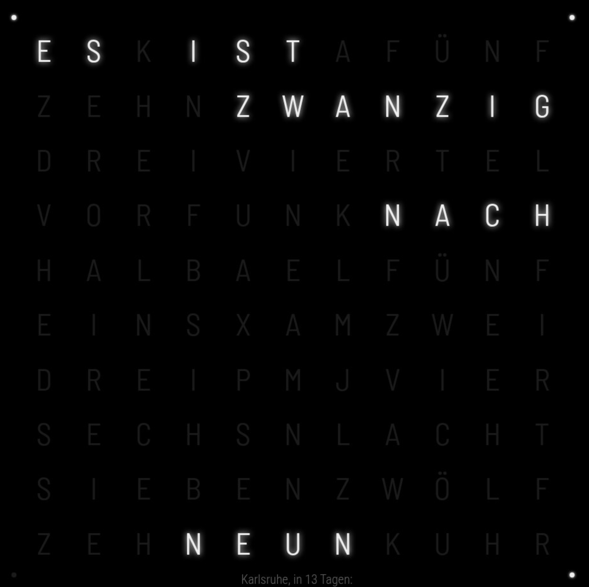

# MMM-WordClock-Native

Lokales, natives WordClock-Modul für MagicMirror.

## Lizenz

Der Modulcode steht unter der MIT License.

Der mitgelieferte Font Barlow Semi Condensed steht unter der SIL Open Font License 1.1.
Siehe `fonts/OFL-Barlow.txt`.

## Eigenschaften

- vollständig lokal
- keine externen Laufzeitabhängigkeiten
- kein iframe
- kein jQuery
- keine npm-Abhängigkeiten
- deutsche Wortuhr mit 10 x 11 Buchstabenmatrix
- vier Minutenpunkte
- "EIN UHR" bei 01:00 und 13:00
- freier Font: Barlow Semi Condensed Regular

## Dateien

- MMM-WordClock-Native.js
- MMM-WordClock-Native.css
- fonts/BarlowSemiCondensed-Regular.woff2
- fonts/OFL-Barlow.txt

## MagicMirror-Konfiguration

module: "MMM-WordClock-Native"
position: "middle_center"
size: "960px"
inactiveOpacity: 0.10

## Font

Barlow Semi Condensed Regular

Lizenz: SIL Open Font License 1.1

Lizenzdatei: fonts/OFL-Barlow.txt
B
